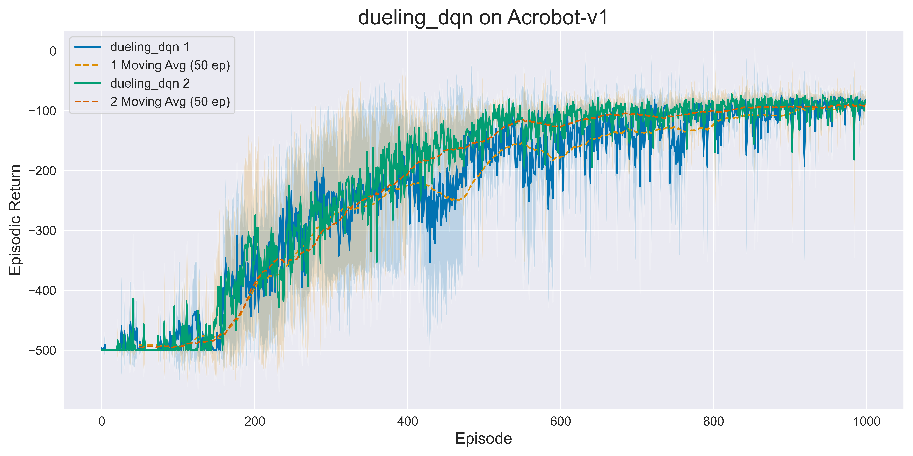
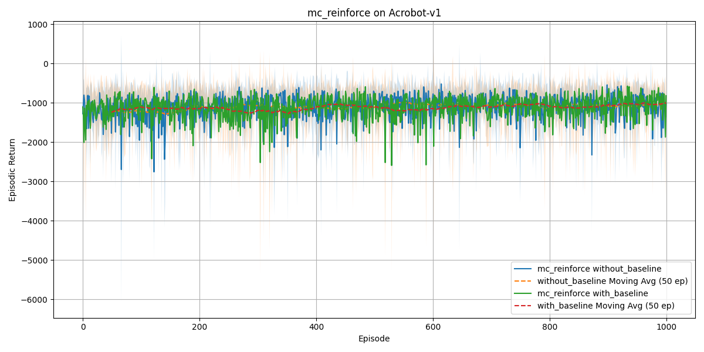
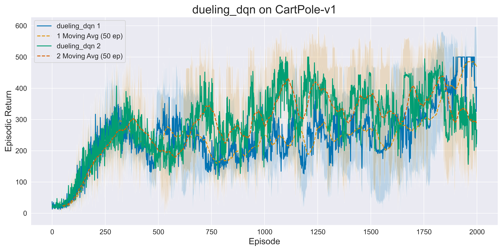
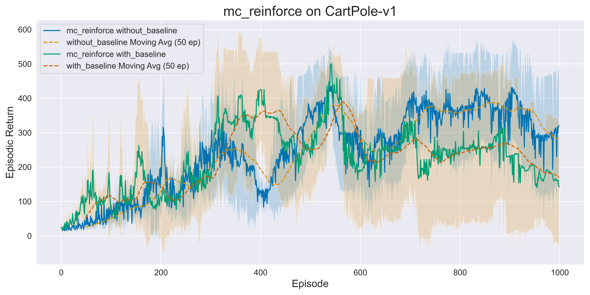

# RL Programming Assignment 2

- Aswin Balamurugan (ch20b018)
- Sanjith Balamurugan (mm20b055)

## Objective

The goal of this assignment is to implement and compare:

1. Two variants of Dueling Deep Q-Network (DQN)
2. Two variants of Monte Carlo REINFORCE (with and without baseline)

Both algorithms are evaluated on two standard OpenAI Gymnasium environments to analyze their performance characteristics.

## Environments

### Acrobot-v1

- **Description**: The system consists of two links connected linearly to form a chain, with one end fixed.
- **Task**: Apply torques on the actuated joint to swing the free end above a given height.
- **Initial State**: Hanging downwards.
- **State Space**: 6-dimensional (joint angles and velocities)
- **Action Space**: 3 discrete actions (applying torque: -1, 0, +1)

### CartPole-v1

- **Description**: A pole attached by an un-actuated joint to a cart moving along a frictionless track.
- **Task**: Balance the pole by applying forces to the cart in left and right directions.
- **Initial State**: Pole positioned upright.
- **State Space**: 4-dimensional (cart position, velocity, pole angle, pole angular velocity)
- **Action Space**: 2 discrete actions (move left or right)

## Algorithms

### Dueling Deep Q-Network (DQN)

Dueling DQN decomposes the Q-value function into two streams:

1. State value function V(s)
2. Advantage function A(s,a)

Two update rules are implemented and compared:

- **Type-1**: Uses the mean advantage normalization

  $Q(s,a; \theta) = V(s; \theta) + (A(s,a; \theta) - \frac{1}{|\mathcal{A}|}\sum_{a'\in\mathcal{A}} A(s,a'; \theta))$

- **Type-2**: Uses the max advantage normalization

  $Q(s,a; \theta) = V(s; \theta) + (A(s,a; \theta) - \max_{a'\in\mathcal{A}} A(s,a'; \theta))$

### Monte Carlo REINFORCE

REINFORCE is a policy gradient method with two variants:

- **Without Baseline**: Standard policy gradient

  $\boldsymbol{\theta} = \boldsymbol{\theta} + \alpha \cdot G_t \cdot \nabla_{\boldsymbol{\theta}} \log \pi(A_t|S_t,\boldsymbol{\theta})$

- **With Baseline**: Uses a learned value function to reduce variance

  $\boldsymbol{\theta} = \boldsymbol{\theta} + \alpha \cdot (G_t - V(S_t;\phi)) \cdot \nabla_{\boldsymbol{\theta}} \log \pi(A_t|S_t,\boldsymbol{\theta})$

The baseline $V(·;Φ)$ is updated using TD(0) method.

## Implementation Details

- Discount factor (γ): 0.99 for all experiments
- Hyperparameter tuning performed to minimize regret
- Results averaged over 5 random seeds for statistical significance
- Neural network architectures with tuned hidden layers
- Proper exploration mechanisms for each algorithm

## Project Structure

```
.
├── algorithms/
│   ├── dueling_dqn.py       # Implementation of Dueling DQN variants
│   └── mc_reinforce.py      # Implementation of REINFORCE variants
├── utils/
│   ├── config.py            # Hyperparameter configurations
│   └── utils.py             # Helper functions for training and visualization
├── results/
│   ├── csv/                 # Training data for analysis
│   ├── models/              # Saved trained models for each algorithm/environment
│   └── plots/               # Performance visualization plots
├── main.py                  # Training and hyperparameter tuning script
├── render_model.py          # Script to visualize trained agent behavior
└── requirements.txt         # Required dependencies
```

## Usage Instructions

### Setup and Installation

1. Clone this repository:

```bash
git clone <repository-url>
cd <repository-directory>
```

2. Install required packages:

```bash
pip install -r requirements.txt
```

### Training

To train the agents and reproduce the results:

```bash
python main.py
```

This will:

1. Perform hyperparameter tuning for each algorithm variant
2. Train models using optimal hyperparameters with 5 random seeds
3. Save the following in the results directory:
   - Trained models (`results/models/`)
   - Performance plots (`results/plots/`)
   - Training data (`results/csv/`)

### Visualization

To visualize a trained agent's performance:

```bash
python render_model.py
```

Follow the interactive prompts to:

1. Select the environment (Acrobot-v1 or CartPole-v1)
2. Choose the algorithm (Dueling DQN or MC REINFORCE)
3. Select the variant to visualize

## Results

Performance results are presented as episodic returns versus episode numbers, with mean and variance across 5 random seeds.

### Acrobot-v1

<table>
  <tr>
    <td></td>
    <td></td>
  </tr>
  <tr>
    <td align="center"><b>Dueling DQN (Type-1 vs Type-2)</b></td>
    <td align="center"><b>REINFORCE (w/o vs w/ Baseline)</b></td>
  </tr>
</table>

### CartPole-v1

<table>
  <tr>
    <td></td>
    <td></td>
  </tr>
  <tr>
    <td align="center"><b>Dueling DQN (Type-1 vs Type-2)</b></td>
    <td align="center"><b>REINFORCE (w/o vs w/ Baseline)</b></td>
  </tr>
</table>

## Hyperparameters

The optimal hyperparameters determined through tuning:

### Acrobot-v1

- **Dueling DQN**:
  - Hidden layers: [[32, 32], [64]]
  - Learning rates: [9e-4, 3e-3]
- **REINFORCE without baseline**:
  - Hidden layers: [[32], [64]]
  - Learning rates: [9e-4, 1e-4]
- **REINFORCE with baseline**:
  - Hidden layers: [[256], [128]]
  - Learning rates: [9e-4, 3e-3]

### CartPole-v1

- **Dueling DQN**:
  - Hidden layers: [[32, 32], [32]]
  - Learning rates: [9e-4, 3e-3]
- **REINFORCE without baseline**:
  - Hidden layers: [[64], [32]]
  - Learning rates: [9e-4, 3e-3]
- **REINFORCE with baseline**:
  - Hidden layers: [[64], [128]]
  - Learning rates: [9e-4, 3e-3]

The final models were trained using 5 random seeds [24, 42, 123, 456, 2023] with the best hyperparameter configuration for each algorithm and environment.
